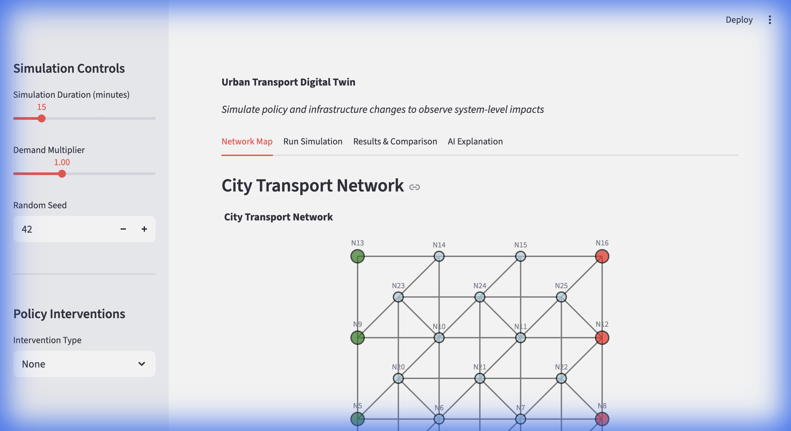
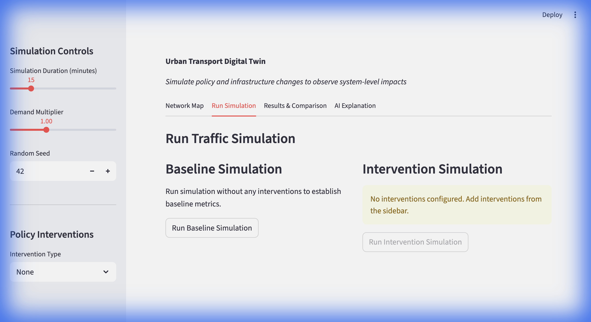
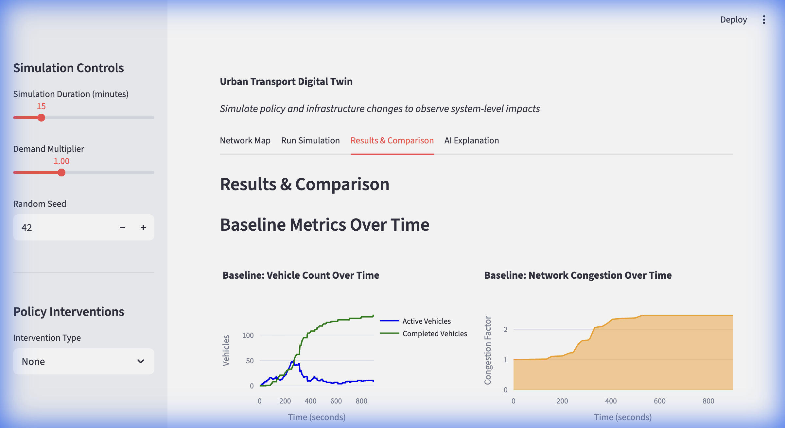
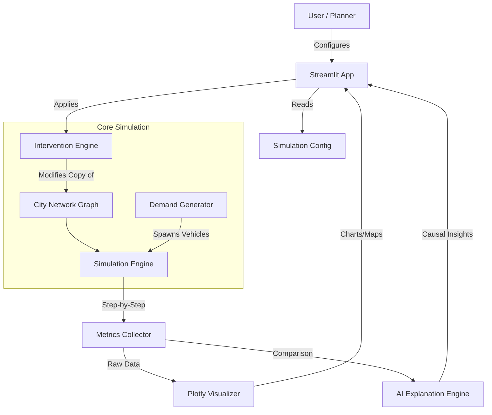
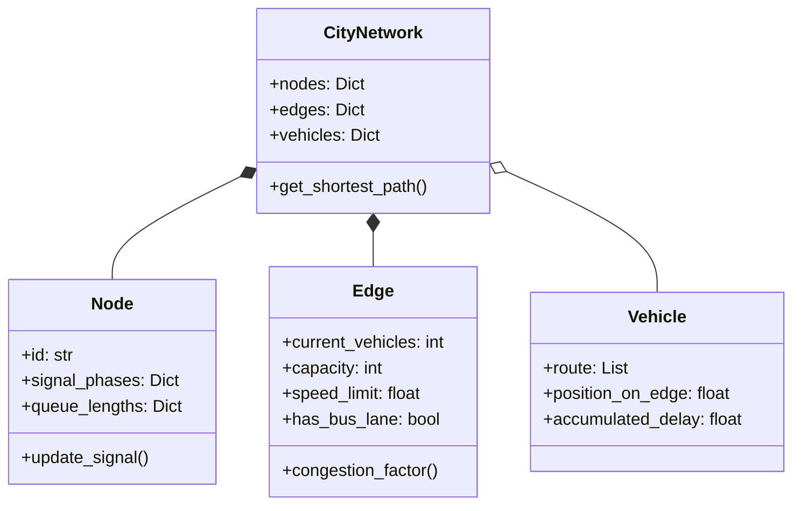

# Urban Transport Digital Twin

A high-fidelity decision support system designed to simulate, analyze, and optimize urban transport networks. This platform allows city planners to test policy interventions (like bus lanes, signal timing changes, and new infrastructure) in a risk-free virtual environment before real-world deployment.




---

## 🚀 Key Features

*   **🚦 High-Fidelity Network Simulation**: Graph-based city model representing intersections (Nodes) and roads (Edges) with realistic physics including congestion, queue spillback, and variable vehicle classes.



*   **🛠️ Policy Intervention Engine**: Apply reversible changes to the network:
    *   **infrastructure**: Add/Remove Bus Lanes, Change Lane Counts.
    *   **Control**: Modify Traffic Signal Timing (Green/Red phases).
    *   **Regulation**: Implement Speed Limits or Vehicle Restrictions.



*   **🧠 AI-Powered Analysis**: Integrated **Azure OpenAI** engine that provides causal explanations for simulation results, identifying *why* a policy worked or failed and detecting second-order effects.
*   **📊 Real-time Analytics**: Interactive dashboards comparing Baseline vs. Intervention scenarios across metrics like Travel Time, Throughput, and Emissions (congestion proxy).
*   **⚠️ Bottleneck Detection**: Automatic identification of network hotspots where demand exceeds capacity.

---

## 🏗️ Architecture

The system is built on a modular architecture separating the data model, simulation logic, policy engine, and presentation layer.

### System Flow


### Data Model Class Diagram


---

## ⚙️ How It Works

### 1. Simulation Engine
The core engine runs a **Discrete Event Simulation**. At every time step (1 second):
1.  **Signal Update**: Traffic lights cycle through Green -> Yellow -> Red based on configured timing.
2.  **Demand Generation**: New vehicles enter the network at entry nodes based on peak/off-peak demand profiles.
3.  **Vehicle Movement**: Vehicles move along edges. Speed is dynamic:
    $$ v_{actual} = v_{limit} \times \frac{1}{\text{CongestionFactor}} $$
4.  **Queue Logic**: If an intersection is Red or the next road is full, vehicles queue up. This enables **spillback** (queues blocking upstream intersections).

### 2. Intervention Logic
Interventions are applied using the **Command Pattern**. High-level policies are translated into low-level network modifications on a *copy* of the city graph, ensuring the baseline remains untouched for comparison.

### 3. AI Explanation
We use Large Language Models (LLM) to bridge the gap between "Data" and "Insight".
*   **Input**: JSON diff of metrics (e.g., "Queue length increased by 15% at Node A").
*   **Processing**: The AI analyzes the network topology and intervention type.
*   **Output**: Natural language explanation (e.g., "Adding a bus lane on Edge X reduced capacity for cars, causing a bottleneck at Node A which spilled back to...").

---

## 💻 Installation & Setup

### Prerequisites
*   Python 3.11+
*   [Optional] Azure OpenAI API Key (for AI features)

### Quick Start

1.  **Clone the repository**
    ```bash
    git clone https://github.com/your-org/urban-twin.git
    cd urban-twin
    ```

2.  **Install Dependencies**
    ```bash
    pip install -r requirements.txt
    ```
    *(Note: Key libraries include `streamlit`, `networkx`, `plotly`, `pandas`, `openai`)*

3.  **Run the Application**
    ```bash
    streamlit run app.py
    ```

4.  **Access the Dashboard**
    Open your browser at `http://localhost:8501`.

### Configuration (AI Features)
To enable the AI Analyst, set the following environment variables:
```bash
export AZURE_OPENAI_ENDPOINT="https://your-resource.openai.azure.com/"
export AZURE_OPENAI_API_KEY="your-api-key"
export AZURE_OPENAI_DEPLOYMENT="gpt-4"
```
*If these are not set, the system falls back to rule-based logic.*

---

## 📖 User Guide

### 1. The Network Map
The landing page shows the current city topology.
*   **Green Nodes**: Entry points (traffic sources).
*   **Red Nodes**: Exit points (traffic sinks).
*   **Edge Colors**: Indicate real-time congestion (Green=Free Flow, Red=Gridlock).

### 2. Running a Scenario
1.  Go to the **"Run Simulation"** tab.
2.  **Baseline**: Click "Run Baseline Simulation". This establishes the "Control" group.
3.  **Interventions**: Use the sidebar to add policies.
    *   *Example*: Select "Add Bus Lane" -> Choose "Edge E12".
4.  **Experiment**: Click "Run Intervention Simulation".

### 3. Analyzing Results
Switch to the **"Results & Comparison"** tab.
*   **Time Series**: Watch how queues build up over time.
*   **Impact Bar Charts**: See the % change in Travel Time and Throughput.
*   **Bottlenecks**: Check the list of "New" vs "Resolved" bottlenecks.

### 4. Getting AI Insights
Go to the **"AI Explanation"** tab and click **"Generate AI Explanation"**.
The AI will provide a report containing:
*   **Primary Effects**: Direct impact of your change.
*   **Side Effects**: Unintended consequences (e.g., traffic diverting to residential streets).
*   **Risk Flags**: Warnings about potential gridlock or safety issues.

---

## 📂 Project Structure

```text
.
├── app.py                      # Main Streamlit Dashboard application
├── models/
│   └── city_model.py           # Core graph data structures (Node, Edge, Network)
├── simulation/
│   ├── simulation_engine.py    # Discrete event simulation loop
│   ├── demand_generator.py     # Probabilistic vehicle spawning logic
│   └── metrics_collector.py    # Statistics aggregation & export
├── policy/
│   └── intervention_engine.py  # Logic for applying network changes
├── ai/
│   └── explanation_engine.py   # Interface to Azure OpenAI
└── data/
    └── sample_network.json     # Default city topology configuration
```

---

## 🔮 Future Roadmap
- [ ] **Multi-Modal Support**: Integration of pedestrians and cyclists.
- [ ] **Carbon Calculator**: Precise CO2 emission modeling based on vehicle stop-start patterns.
- [ ] **3D Visualization**: Upgrade from 2D Plotly maps to a 3D WebGL view using PyDeck.
- [ ] **Live Data Feed**: Integration with real-world traffic sensor APIs.

---

## 📄 License
This project is licensed under the MIT License - see the LICENSE file for details.
